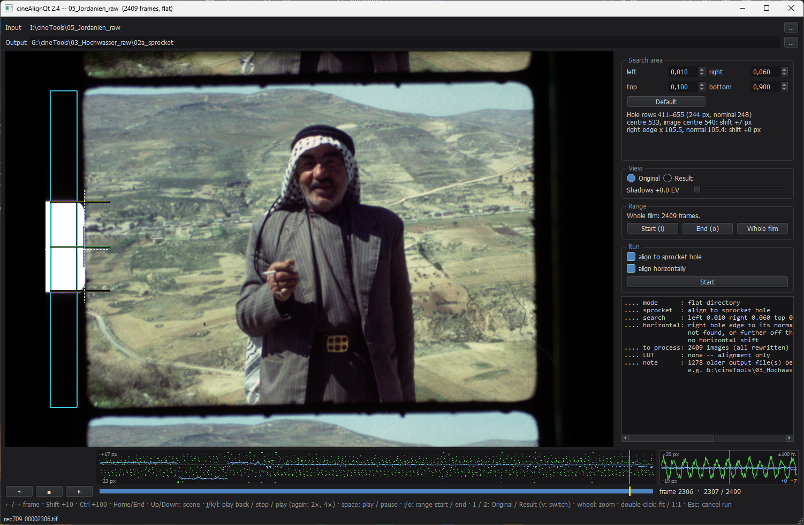

# cineAlign — Aligning Film Scans in Position and Colour



*cineAlignQt — the search area on the sprocket hole, and the shift found for every frame of the reel.*

cineAlign brings the frames of a film scan into line in two respects: where the picture sits, and what its colours are.

A film scanner rarely places two frames at exactly the same position. What stays fixed relative to the picture is the sprocket hole, and on an overscanned frame it is in the scan. cineAlign finds the hole in every frame and shifts the frame so that the hole always sits at the same place.

The vertical position comes from the centre of the hole. Sideways the hole is only an approximation: in Super 8 the lateral reference is the film edge opposite the perforation, and hardly any scanner records that edge. The hole is what a scan has to offer, so the horizontal alignment uses the edge of the hole that faces the picture. It is optional and switched off by default, and the two directions are switched independently. It helps where the film moves sideways in the scan, for instance at rough splices, where it is pushed aside in the gate for a few frames.

Frames are moved by whole pixels and are not resampled.

Detection calibrates itself on every frame: the open hole is the brightest thing in the search area, and its own brightness is the reference. Exposure and tone mapping of the scan therefore do not matter. A fibre lying across the hole is bridged, and where the upper edge of a hole is torn, the centre is taken from the lower edge.

> **Note:** cineAlign needs reversal film. The hole is found because the film around it is dark; on negative film, or on any film with a clear base in the perforation band, the method does not work.

In the same pass the primary colour correction is applied, if LUTs are available: a LUT for the whole film, and separate LUTs for the parts of it that need a different correction. Otherwise only the registration to the sprocket hole is performed.

cineAlign is one of the cineTools, next to [cineFlow](https://github.com/cpixip/cineFlow) and [cineColor](https://github.com/cpixip/cineColor).

## The two programs

| | |
|---|---|
| **cineAlignQt.py** | the program with a window. Shows the material, lets you place the search area on the sprocket hole, shows what is found in each frame and the shift over the whole reel, and starts the run. |
| **cineAlign.py** | the same run from the console, without a window. It uses the search area and the switches that cineAlignQt stored with the material. |

## What goes in, what comes out

Input is a folder of frames scanned from reversal film — TIFF, PNG or JPG, 8 or 16 bit — either directly in the folder or in one level of scene folders, which are mirrored in the output.

The frame number is read from the digits at the end of the file name, and the output carries it: `Scene00000955.tif` becomes `SPR_00000955.tif`. Output is always TIFF, at the bit depth of the input.

Two small files are written besides the frames:

- `_cineAlign/cineAlign.json` in the input folder — the search area and the two alignment switches (vertical, horizontal). They belong to the material, since they depend on how it was scanned.
- `cineAlign_run.json` in the output folder — what the run did: search area, alignment, LUTs, number of frames.

## Colour

While writing, cineAlign applies a LUT if it finds one next to the material: `csample.cube` in the input folder or in its sub-folder `_LUT`. A file named `csample_<first>-<last>.cube` replaces it for the frames in that range.

These files are what [cineColor](https://github.com/cpixip/cineColor) writes. Any other 1D LUT in `.cube` format will do as well:

```
LUT_1D_SIZE 1024
LUT_1D_INPUT_RANGE 0.0 1.0
0.000000 0.000000 0.000000
...
```

`DOMAIN_MIN` / `DOMAIN_MAX` are understood as well. The LUT maps code values to code values, channel by channel. 3D LUTs are not supported, and the run stops before the first frame if it meets one.

## Installation

cineAlign is a set of Python scripts; put them in one folder. It needs Python 3.11 or newer and three packages:

```
pip install numpy opencv-python PyQt5
```

| package | used for |
|---|---|
| `numpy` | all the arithmetic |
| `opencv-python` | reading and writing the frames, shifting them |
| `PyQt5` | the window of cineAlignQt; `cineAlign.py` runs without it |

Then start it:

```
python cineAlignQt.py
```

## A first run

1. Drop the folder with your frames on the window and name an output folder. With 50000 frames, reading the folder takes a little while.
2. Place the search area on the sprocket hole: drag its edges, or drag inside it to move it. For horizontal alignment it has to lie inside the hole, with its right border left of the hole's edge.
3. Press the space bar: the reel plays, and you see the detected sprocket position frame by frame. Pressing space again stops it. The lines in the picture show what is found in the current frame, the plot below shows the shift of every frame visited so far. Keys `1` and `2` switch between the frame as scanned and the frame as it will be written.
4. Press **Start**. The output folder is shown once more for confirmation, then every frame is written. While the run goes on, the window shows the frame just written, about once a second, and the plot below fills in with the shift of every frame processed so far.

For scanners that deliver the frames upside down, **Flip** (key `y`) turns the display over; detection, search area and output are not affected.

The line at the bottom of the window lists the keys.

## Status

This is version 2.6: working software that one person uses on his own films, published in the hope that it is useful to others.

**No support is promised.** Bug reports are welcome and will be read.

## Licence

GPL-3.0-or-later. See [LICENSE](LICENSE).

Commercial licences are available for use cases the GPL does not cover.
Enquiries: license@pixelcircus.com

Copyright (C) 2026 Dr. R. Henkel
